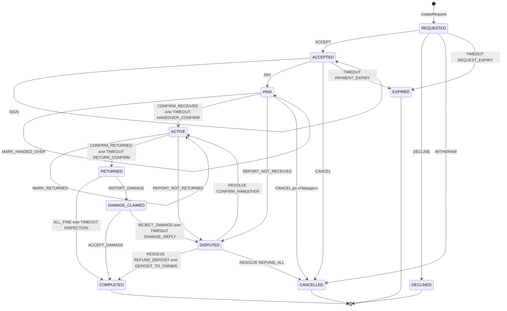

# @yoyo/domain — ядро правил Yoyo

Бизнес-правила Yoyo в виде чистых функций: деньги, цены, календарные дни, сделка с залогом и журнал проводок кошелька.

- Здесь нет базы, HTTP и часов. Время приходит снаружи как `ctx.now`.
- Всё, что нужно сделать после решения, возвращается **данными** (эффектами): проводки, таймеры, занятие дат, договор, уведомления, системные сообщения чата. API (план 8) выполняет их в одной транзакции вместе с сохранением сделки.
- Функции детерминированы: одинаковые аргументы дают одинаковый результат. Тест `purity.test.ts` не пропустит в `src/` чтение часов, случайные числа, переменные окружения и ввод-вывод.
- Ошибка правила — это `DomainError` с кодом из закрытого списка `DOMAIN_ERROR_CODES` и необязательными `details`. Коды переводит в HTTP-ответы API.

Спецификация: [`docs/superpowers/specs/2026-11-03-yoyo-design.md`](../../docs/superpowers/specs/2026-11-03-yoyo-design.md), §0 и §4.3–§4.6. План: [`docs/superpowers/plans/2026-11-04-yoyo-04-domain-core.md`](../../docs/superpowers/plans/2026-11-04-yoyo-04-domain-core.md).

```ts
import { DEFAULT_BOOKING_SETTINGS, availableActions, decide } from '@yoyo/domain';

const ctx = { now, settings: DEFAULT_BOOKING_SETTINGS, blocked, walletAvailableCents };
const buttons = availableActions(snapshot, { kind: 'OWNER', userId }, ctx); // например ['ACCEPT', 'DECLINE']
const { next, effects } = decide(snapshot, { kind: 'OWNER', userId }, { type: 'ACCEPT' }, ctx);
// сохранить next и выполнить effects в одной транзакции; DomainError превратить в HTTP-ответ
```

## Модули

| Файл | Что внутри |
|------|------------|
| `errors.ts` | `DomainError`, `DOMAIN_ERROR_CODES` |
| `money.ts` | `Cents`, `cents`, `add`, `sub`, `mulInt`, `percentOf`, `formatMoney` |
| `dates.ts` | `LocalDate`, `localDate`, `localDateIn`, `addDays`, `diffDays`, `compareDates`, `endOfDayIn`, `Period`, `period`, `daysIn`, `overlaps`, `firstConflict`, `validateRentalPeriod`, `DEFAULT_TIME_ZONE` |
| `pricing.ts` | `ListingPricing`, `PRICING_LIMITS`, `validatePricing`, `Quote`, `quote`, `validateOffer`, `WEEKLY_DISCOUNT_FROM_DAYS` |
| `settings.ts` | `BookingSettings`, `DEFAULT_BOOKING_SETTINGS`, `validateBookingSettings` |
| `ledger.ts` | `AccountId`, `Posting`, `LedgerOperation`, `PaymentMethod`, конструкторы операций, `assertBalanced`, `applyOperation` |
| `booking/types.ts` | `BookingStatus`, `BookingSnapshot`, `Actor`, `BookingEvent`, `TimerKind`, `Effect`, `Decision`, `DecideContext`, `BOOKING_TEMPLATES` |
| `booking/request.ts` | `createRequest` — запрос арендатора |
| `booking/transitions.ts` | таблица переходов, одна структура данных (внутренний модуль) |
| `booking/decide.ts` | `decide` — применяет событие по таблице |
| `booking/actions.ts` | `availableActions` — какие кнопки показать, по той же таблице |
| `reviews.ts` | `canReview` — открыто ли окно отзывов |

Всё публичное экспортируется из `src/index.ts`. `index.test.ts` сверяет список экспорта.

## Деньги

- Сумма — целые центы EUR, не меньше нуля (`Cents`). Дробных денег нет нигде.
- Проценты — целые от 0 до 100. Округление одно, до цента, вверх от половины: `⌊(сумма × процент + 50) / 100⌋`. Сбор 10 % с 12,34 € — 1,23 €, с 0,05 € — 0,01 €, с 0,04 € — 0 €.
- `formatMoney`: en → `€1,234.50`, lv и ru → `1 234,50 €`. Разряды отделяются во всех трёх языках, даже в четырёхзначных суммах.

## Дни и периоды

- `LocalDate` — день `YYYY-MM-DD` без времени и пояса. Дни считаются по Y-M-D в UTC, поэтому переход на летнее время не добавляет и не съедает день.
- Период включает оба конца: дней = `end − start + 1`. Аренда с 27 по 29 марта 2027 — 3 дня, хотя 28-го в Риге переводят часы.
- «Сегодня» для вещи — `localDateIn(now, timeZone)`, пояс по умолчанию `Europe/Riga`. В 22:30 UTC 3 ноября 2026 в Риге уже 4 ноября.
- `endOfDayIn(date, timeZone)` — первый момент следующего дня в этом поясе, обычно местная полночь. Конец 28.03.2027 в Риге — `2027-03-28T21:00:00Z`. Где часы перескакивают через полночь (Гавана, 14.03.2027), день кончается в момент скачка.
- `overlaps` — периоды пересекаются, если у них есть общий день. `firstConflict` возвращает пересекающийся занятый период с самым ранним началом.

## Цена (`quote`)

1. Цена в день: договорная (`agreedDailyCents`, принятое предложение цены) или из объявления.
2. `base = цена в день × дни`.
3. Недельная скидка — от 7 дней и только без договорной цены. Договорная цена окончательная, скидки с ней не складываются.
4. `rent = base − скидка`, `fee = percentOf(rent, servicePercent)`. Скидка и сбор считаются от сумм за весь период, а не по дням.
5. `total = rent + fee + deposit` — платит арендатор. `ownerPayout = rent` — получает владелец.

Срок вне `[minDays, maxDays]` объявления — `PERIOD_TOO_SHORT` или `PERIOD_TOO_LONG`. Пределы цен лежат в `PRICING_LIMITS`, их проверяет `validatePricing`. `validateOffer` пропускает предложение от 1 € и строго ниже цены объявления.

## Кошелёк: журнал проводок

Каждое движение денег — операция из проводок. Сумма проводок операции всегда равна нулю: деньги перемещаются, но не появляются и не пропадают. Баланс счёта — сумма его проводок.

| Счёт | Что это |
|------|---------|
| `wallet:<userId>` | доступный баланс пользователя, не меньше нуля |
| `escrow:<bookingId>` | арендная плата, которую Yoyo держит до подтверждённой передачи |
| `deposit:<bookingId>` | замороженный залог |
| `platform:revenue` | сервисные сборы Yoyo |
| `external:card` | внешний мир (имитация карты); минус — деньги пришли извне |

| Операция | Проводки |
|----------|----------|
| `TOP_UP` | карта −, кошелёк + |
| `WITHDRAWAL` | кошелёк −, карта + |
| `BOOKING_PAYMENT` | плательщик − total; escrow + rent; deposit + залог; revenue + сбор |
| `RENT_RELEASE` | escrow − rent; кошелёк владельца + rent |
| `DEPOSIT_REFUND` | deposit − залог; плательщик + залог |
| `DEPOSIT_TO_OWNER` | deposit − залог; кошелёк владельца + залог |
| `BOOKING_REFUND` | escrow − rent; deposit − залог; revenue − сбор; плательщик + total |

- Плательщик — кошелёк арендатора (`WALLET`) или карта (`CARD`). **Деньги возвращаются тем же способом, которым платили**: и полный возврат, и возврат залога.
- Нулевые суммы проводок не дают. Операция, в которой нечего перемещать (залог 0), — это `null`, а не пустая операция.
- `applyOperation` не пускает кошелёк ниже нуля (`INSUFFICIENT_FUNDS`), а escrow и залог — ниже нуля (`NEGATIVE_BALANCE`). У карты и счёта Yoyo ограничений нет.

## Сделка

Снимок сделки (`BookingSnapshot`) хранит API. Ядро получает снимок, актёра, событие и контекст и возвращает новый снимок и эффекты: `decide(snapshot, actor, event, ctx) → { next, effects }`. Первый шаг, запрос арендатора, делает `createRequest`.



### Таблица переходов

`ttl(x) = min(now + x часов, endOfDayIn(period.start, timeZone))`: после конца первого дня аренды неотвеченный запрос и неоплаченная бронь теряют смысл. Таймеры передачи, возврата, проверки и ответа на повреждение — `now + x часов`.

| Из | Событие (кто) | Условие | В | Эффекты |
|---|---|---|---|---|
| — | `createRequest` (арендатор) | не своя вещь (`CANNOT_RENT_OWN`); начало от сегодня до `maxAdvanceDays`, длина в пределах объявления; даты свободны (`DATES_UNAVAILABLE`); договорная цена ниже цены объявления (`INVALID_OFFER`) | REQUESTED | SCHEDULE REQUEST_EXPIRY `ttl(requestTtlHours)`; NOTIFY OWNER; SYSTEM_MESSAGE REQUESTED |
| REQUESTED | ACCEPT (владелец) | `ctx.blocked` передан; даты свободны (`DATES_UNAVAILABLE`) | ACCEPTED | CANCEL_TIMER REQUEST_EXPIRY; SCHEDULE PAYMENT_EXPIRY `ttl(paymentTtlHours)`; RESERVE_DATES; GENERATE_CONTRACT; NOTIFY RENTER; SYSTEM_MESSAGE ACCEPTED |
| REQUESTED | DECLINE{reason?} (владелец) | — | DECLINED | CANCEL_TIMER; NOTIFY RENTER; SYSTEM_MESSAGE DECLINED |
| REQUESTED | WITHDRAW (арендатор) | — | CANCELLED (by RENTER) | CANCEL_TIMER; NOTIFY OWNER; SYSTEM_MESSAGE CANCELLED |
| REQUESTED | TIMEOUT REQUEST_EXPIRY | таймер взведён, срок наступил | EXPIRED | NOTIFY RENTER и OWNER; SYSTEM_MESSAGE EXPIRED |
| ACCEPTED | SIGN (любая сторона) | повторная подпись ничего не меняет | ACCEPTED | SYSTEM_MESSAGE SIGNED |
| ACCEPTED | PAY{method} (арендатор) | обе подписи (`CONTRACT_NOT_SIGNED`); для WALLET `walletAvailableCents ≥ total` (`INSUFFICIENT_FUNDS`) | PAID | CANCEL_TIMER PAYMENT_EXPIRY; LEDGER bookingPayment; NOTIFY OWNER; SYSTEM_MESSAGE PAID |
| ACCEPTED | CANCEL{reason} (любая сторона) | — | CANCELLED | CANCEL_TIMER; RELEASE_DATES; NOTIFY другой стороне; SYSTEM_MESSAGE CANCELLED |
| ACCEPTED | TIMEOUT PAYMENT_EXPIRY | таймер взведён, срок наступил | EXPIRED | RELEASE_DATES; NOTIFY RENTER и OWNER; SYSTEM_MESSAGE EXPIRED |
| PAID | MARK_HANDED_OVER (владелец) | ещё не отмечено | PAID | SCHEDULE HANDOVER_CONFIRM `now + handoverConfirmHours`; NOTIFY RENTER; SYSTEM_MESSAGE HANDED_OVER |
| PAID | CONFIRM_RECEIVED (арендатор) или TIMEOUT HANDOVER_CONFIRM | — | ACTIVE | CANCEL_TIMER HANDOVER_CONFIRM, если взведён; LEDGER rentRelease; NOTIFY OWNER; SYSTEM_MESSAGE RECEIVED |
| PAID | REPORT_NOT_RECEIVED{note} (арендатор) | владелец отметил «Передал» | DISPUTED (NOT_HANDED_OVER) | CANCEL_TIMER HANDOVER_CONFIRM; NOTIFY ADMINS и OWNER; SYSTEM_MESSAGE DISPUTE_OPENED |
| PAID | CANCEL{reason} (любая сторона) | владелец **ещё не** отметил «Передал» | CANCELLED (REFUNDED_ALL) | LEDGER bookingRefund; RELEASE_DATES; NOTIFY другой стороне; SYSTEM_MESSAGE CANCELLED |
| ACTIVE | MARK_RETURNED (арендатор) | ещё не отмечено | ACTIVE | SCHEDULE RETURN_CONFIRM `now + returnConfirmHours`; NOTIFY OWNER; SYSTEM_MESSAGE RETURNED |
| ACTIVE | CONFIRM_RETURNED (владелец) или TIMEOUT RETURN_CONFIRM | — | RETURNED | CANCEL_TIMER RETURN_CONFIRM, если взведён; SCHEDULE INSPECTION `now + inspectionHours`; RELEASE_DATES; NOTIFY RENTER; SYSTEM_MESSAGE RECEIVED_BACK |
| ACTIVE | REPORT_NOT_RETURNED{note} (владелец) | арендатор отметил «Вернул» **или** сегодня позже `period.end` | DISPUTED (NOT_RETURNED) | CANCEL_TIMER RETURN_CONFIRM, если взведён; NOTIFY ADMINS и RENTER; SYSTEM_MESSAGE DISPUTE_OPENED |
| RETURNED | ALL_FINE (владелец) или TIMEOUT INSPECTION | — | COMPLETED (DEPOSIT_REFUNDED) | CANCEL_TIMER INSPECTION; LEDGER depositRefund; NOTIFY RENTER; SYSTEM_MESSAGE ALL_FINE |
| RETURNED | REPORT_DAMAGE{description 10–2000 символов, photoIds 1–8} (владелец) | — | DAMAGE_CLAIMED | CANCEL_TIMER INSPECTION; SCHEDULE DAMAGE_REPLY `now + damageReplyHours`; NOTIFY RENTER; SYSTEM_MESSAGE DAMAGE_REPORTED |
| DAMAGE_CLAIMED | ACCEPT_DAMAGE (арендатор) | — | COMPLETED (DEPOSIT_TO_OWNER) | CANCEL_TIMER DAMAGE_REPLY; LEDGER depositToOwner; NOTIFY OWNER; SYSTEM_MESSAGE DAMAGE_ACCEPTED |
| DAMAGE_CLAIMED | REJECT_DAMAGE{note} (арендатор) или TIMEOUT DAMAGE_REPLY | — | DISPUTED (DAMAGE) | CANCEL_TIMER DAMAGE_REPLY; NOTIFY ADMINS и OWNER; SYSTEM_MESSAGE DISPUTE_OPENED |
| DISPUTED (DAMAGE, NOT_RETURNED) | RESOLVE{REFUND_DEPOSIT или DEPOSIT_TO_OWNER, comment} (админ) | — | COMPLETED (DEPOSIT_REFUNDED или DEPOSIT_TO_OWNER) | LEDGER depositRefund или depositToOwner; RELEASE_DATES, если NOT_RETURNED; NOTIFY RENTER и OWNER; SYSTEM_MESSAGE DISPUTE_RESOLVED |
| DISPUTED (NOT_HANDED_OVER) | RESOLVE{REFUND_ALL, comment} (админ) | — | CANCELLED (by ADMIN, REFUNDED_ALL) | LEDGER bookingRefund; RELEASE_DATES; NOTIFY RENTER и OWNER; SYSTEM_MESSAGE DISPUTE_RESOLVED |
| DISPUTED (NOT_HANDED_OVER) | RESOLVE{CONFIRM_HANDOVER, comment} (админ) | — | ACTIVE | LEDGER rentRelease; NOTIFY RENTER и OWNER; SYSTEM_MESSAGE DISPUTE_RESOLVED |

### Правила для всех строк

- **Настройки и даты.** `createRequest`, `decide` и `availableActions` сначала проверяют `ctx.now` и настройки (`validateBookingSettings`): часы — конечное число больше 0, `servicePercent` — целое от 0 до 100, `maxAdvanceDays` и `reviewWindowDays` — целые больше 0. Иначе `INVALID_INPUT` с `details.field = 'settings.<имя>'`. Сохранённый срок таймера, который не является настоящей датой, не срабатывает и не считается «ещё не наступившим»: `INVALID_INPUT` с `details.field = 'timers.<таймер>'`. Каждый срок, который ставит ядро, проверяется так же.
- **Кто может действовать.** RENTER и OWNER — только арендатор и владелец этой сделки, иначе `NOT_A_PARTY`. ADMIN может только RESOLVE, SYSTEM — только TIMEOUT. Событие, которого нет в таблице для этого статуса и актёра, — `TRANSITION_NOT_ALLOWED`. Невыполненное условие без своего кода — тоже `TRANSITION_NOT_ALLOWED` с `details.why`.
- **Таймеры.** У сделки взведён не больше чем один таймер — таймер текущего шага.
  - TIMEOUT для таймера, который не взведён или срок которого не наступил, ничего не меняет: `next === snapshot`, эффектов нет, ошибки нет. Фоновая задача может сработать поздно, дважды или рано без вреда.
  - Срок важнее опоздавшей задачи. Если срок взведённого таймера прошёл, сделка принимает только его TIMEOUT. Любое другое событие — `TRANSITION_NOT_ALLOWED` с `details.overdueTimer`. Так владелец не примет запрос и не заявит о повреждении после срока, даже если планировщик опоздал.
  - Уходя из статуса, сделка снимает его таймер эффектом CANCEL_TIMER. Таймер, который только что сработал, просто убирается из `next.timers`.
- **Залог 0.** Переходы те же, проводок с залогом нет.
- **Тексты.** Причины, заметки и комментарий админа — от 1 до 2000 символов, не пустые. Описание повреждения — от 10 до 2000 символов, фото — от 1 до 8 разных.
- **Неизменяемость.** `next` — новый объект, `snapshot` не меняется. `updatedAt = now`; при переходе в COMPLETED заполняется `completedAt`.
- **Порядок эффектов:** сначала CANCEL_TIMER, затем SCHEDULE, затем остальные эффекты строки в порядке таблицы.

### Что делает API с эффектами (план 8)

- Сохраняет `next` и выполняет все эффекты в одной транзакции.
- `LEDGER` — записывает операцию в журнал. Перед `PAY` из кошелька передаёт в `ctx.walletAvailableCents` баланс из журнала.
- `SCHEDULE` и `CANCEL_TIMER` — ставит и снимает задачу. Снятие должно быть идемпотентным.
- На `TRANSITION_NOT_ALLOWED` с `details.overdueTimer` сначала выполняет этот TIMEOUT, а потом показывает пользователю новое состояние.
- `RESERVE_DATES` и `RELEASE_DATES` — занимает и освобождает даты. Двойную бронь исключает ограничение в базе. Перед `ACCEPT` в `ctx.blocked` передаются занятые периоды без этой сделки.
- `NOTIFY` и `SYSTEM_MESSAGE` — шаблоны из `BOOKING_TEMPLATES`. Тексты лежат в переводах.

### Кнопки и отзывы

- `availableActions(snapshot, actor, ctx)` — события, которые `decide` примет от актёра сейчас, в порядке таблицы. Сайт показывает по кнопке на каждое. Повторное действие (вторая подпись) кнопкой не считается. PAY показывается после обеих подписей, даже если в кошельке не хватает денег: можно заплатить картой. После срока сторонам нечего нажать, у системы есть TIMEOUT.
- `canReview(snapshot, now, settings)` — сделка COMPLETED и `now ≤ completedAt + reviewWindowDays` (дни по 24 часа).

## Пример: 3 дня по 15 €, залог 100 €, оплата картой

Цена: `base` 45,00 €, скидки нет (меньше 7 дней), `rent` 45,00 €, сбор 10 % — 4,50 €, залог 100,00 €, `total` 149,50 €.

| Шаг | Событие | Проводки | escrow | deposit | Yoyo | владелец |
|-----|---------|----------|-------:|--------:|-----:|---------:|
| 1 | PAY (CARD) | карта −149,50 · escrow +45,00 · deposit +100,00 · revenue +4,50 | 45,00 | 100,00 | 4,50 | 0 |
| 2 | CONFIRM_RECEIVED | escrow −45,00 · кошелёк владельца +45,00 | 0 | 100,00 | 4,50 | 45,00 |
| 3 | ALL_FINE | deposit −100,00 · карта +100,00 | 0 | 0 | 4,50 | 45,00 |

Итог: арендатор заплатил 49,50 € (149,50 с карты, 100,00 вернулось на карту), владелец получил 45,00 €, Yoyo — 4,50 €. Escrow и залог пусты.

Другие концовки той же сделки:
- **Повреждение признано.** Шаги 1–2, затем REPORT_DAMAGE и ACCEPT_DAMAGE: deposit −100,00 · кошелёк владельца +100,00. Владелец получил 145,00 €.
- **Отмена до «Передал».** После шага 1 CANCEL: escrow −45,00 · deposit −100,00 · revenue −4,50 · карта +149,50. Всё вернулось, `outcome = REFUNDED_ALL`.
- **Оплата из кошелька.** То же самое, только вместо «карта» везде кошелёк арендатора, и залог возвращается в кошелёк.

## Тесты

`pnpm --filter @yoyo/domain test`:
- деньги, дни, цена, журнал — граничные случаи из Review Focus 4 и 5;
- каждая строка таблицы переходов: статус, итог, эффекты и операции журнала;
- полный перебор: каждое событие, которого нет в таблице для статуса и актёра, отклоняется;
- таймеры: поздние, повторные и ранние ничего не меняют, после срока действует только таймер;
- `availableActions` совпадает с `decide` в каждом статусе и для каждого актёра;
- свойство (fast-check, 1000 случайных сделок до конца): каждая операция сбалансирована, кошельки не уходят в минус, в конце escrow и залог пусты, Yoyo получает сбор только с оплаченных и не возвращённых сделок, а владелец — аренду и признанный залог. Тест проверяет, что случайные пути дошли до каждой концовки.
